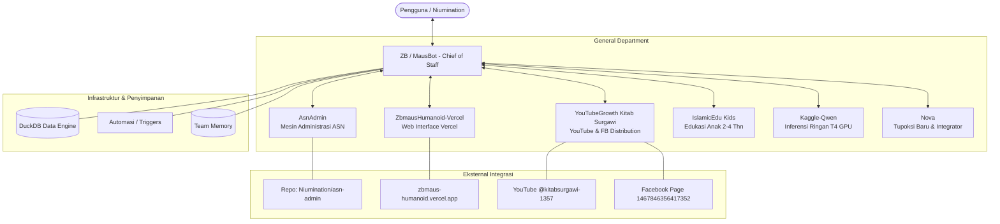

# Arsitektur Ekosistem zbmaus

## Prinsip Koordinasi
1. **Single Point of Contact**: Pengguna berinteraksi langsung melalui ZB.
2. **Spesialis Mandiri**: Setiap agen memegang ranah domain tertentu (ASN, Media/Dakwah, Web frontend, Edukasi, Riset/Tupoksi).
3. **Koordinasi Peer**: ZB mendelegasikan tugas menggunakan `coordinate_bots` tanpa mengambil alih otoritas internal spesialis.
4. **Penanganan Insiden Terpusat**: Kegagalan agen (seperti limit kuota token atau perubahan status model gratis) dilaporkan ke ZB untuk ditangani atau dikomunikasikan secara transparan ke pengguna.
